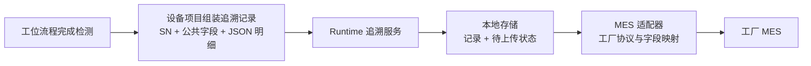

# 第一期开源骨架架构

## 分层

```text
MotionControl.Host.Wpf
  ├─ MotionControl.Framework.Runtime
  ├─ MotionControl.Framework.Wpf
  ├─ MotionControl.Framework.Contracts
  ├─ 一个选定的 MotionControl.Equipment.* 项目
  └─ 所需的 Adapters.* 项目

MotionControl.Framework.Runtime ──> MotionControl.Framework.Contracts
MotionControl.Framework.Wpf     ──> Runtime + Contracts
MotionControl.Equipment.*       ──> Contracts
Adapters.*                     ──> Contracts
```

运行时不引用设备项目或具体厂商实现。设备流程不直接调用厂商 DLL、物理轴号或协议报文。Host 是组合根，负责明确引用当前设备项目和所需适配模块。

## 模块职责

- `Framework.Contracts`：运动控制、逻辑 IO、流程生命周期、报警、配置、诊断和追溯等稳定边界；具体接口在确认使用场景后逐项定义，避免预先做成一个大型总接口。
- `Framework.Runtime`：默认单机运行上下文；管理工位流程调度、启停暂停、报警处理、配置服务、本地追溯队列等通用能力。
- `Framework.Wpf`：通用轴与逻辑 IO 手动调试 UI。框架不预设客户主窗口样式。
- `Host.Wpf`：应用入口、基础主窗口、导航和组合根。后续按客户模板调整。
- `Equipment.*`：逻辑轴/IO 映射、C# 工位流程、设备报警、参数/配方、追溯字段、设备专属页面和手动动作。
- `Adapters.*`：运动卡厂商/型号、Modbus/TCP/自定义通讯、本地存储及 MES 协议的独立实现。
- `MotionControl.VendorApi.*`：厂商原生 P/Invoke 声明。具体驱动适配器引用这些项目并实现通用契约；框架运行时和设备流程不引用它们。

## 第一阶段约定

- 一个 Host 部署选择并引用一个设备项目；不实现运行时热插拔设备项目。
- 每个设备部署由 Host 明确绑定一个设备项目和一种运动卡适配器；设备运行期间不按配置切换厂商适配器，也不扫描目录动态加载。运动控制器数量允许按设备配置为一张或多张，默认单卡。
- 本机配置保存所选适配器使用的卡号、连接信息和轴通道等硬件参数；厂商适配器的选择属于 Host 组合配置，不属于工艺流程或可现场修改的轴参数。
- 流程按逻辑轴名和逻辑 DI/DO 名调用。DI/DO 名称映射到运动卡或远程 IO 的物理点位；PLC 的 Modbus 点位按带名称和数据类型的协议数据点管理，命令握手逻辑留在设备项目；视觉等设备的自定义 TCP 报文按具体协议组织，不作为普通 IO 点。
- 轴硬件参数与工艺动作参数分开集中管理：轴参数保存通道、工程单位换算、软限位、回零、手动速度和默认运动参数；工艺参数保存命名动作的目标位置与动作速度。
- 默认加减速度由轴参数提供。只有某个工艺动作确实需要不同的加减速度时，才在该动作的工艺参数中覆盖。
- 轴参数、DI/DO 映射与工艺动作参数分别集中管理，并随设备项目维护：`HardwareConfig/AxisParameters.json` 保存轴硬件参数，`HardwareConfig/IoMapping.json` 保存逻辑 DI/DO 到物理点位的映射，`Parameters/ProcessParameters.json` 保存工艺动作参数。设备项目内的文件作为同型号设备的默认模板。
- 每台已部署的物理设备有唯一 `MachineId` 和独立的生效配置。同型号设备共用程序版本和配置模板，但现场调试后的轴参数、IO 映射、通讯参数和工艺参数各自保存；生效配置放在软件发布目录之外。
- 首次部署时，从默认模板建立该设备的生效配置。软件升级不覆盖生效配置；配置格式变更时先备份，再按版本迁移并验证。
- 设备级调试参数与产品配方分开。产品配方以后可由同型号的多台设备共用；首期不建设中央配置服务器。
- Runtime 统一管理整机状态和启动、暂停、复位命令，并把运行控制协调到各工位；设备项目以 C# 流程步描述各自工艺。多个工位可以并行运行，通过设备定义的请求/完成信号协作。
- 停机报警使整机暂停并保留各工位当前步骤；故障处理并复位后，重新启动时从中断步骤重新进入。非停机报警在触发条件恢复后自动消失，不中断整机流程。
- 急停与普通流程暂停、复位分开处理。共享轴或运动区域的避让规则暂不做通用机制，待具体设备案例明确后再决定。
- 列表式流程编辑器留待未来独立设计。
- 轴和 DI/DO 是基础硬件能力。气缸、真空、夹爪等组合对象由设备项目提供；多个设备确认共性后再抽成可选模块。
- SN 是产品追溯的主要关联键。设备项目定义采集字段；运行时先保存生产记录，再交给本地持久化的待上传队列；MES 适配器处理工厂协议与字段映射。记录包含稳定的公共字段，新增检测项放入带版本的 JSON 明细，避免每增加一项就改数据库列。
- 停机报警与非停机报警由运行时统一管理；设备项目定义具体报警。急停链路与普通流程暂停/复位分开处理。

### 架构决策记录：IO 与设备通讯边界

**背景：** 参考工程 UAMP 与 Leadshine POL 都把 DI/DO 作为具名配置点，再关联到板卡、模块或通道。HLAMotion 的 PLC 联机部分把寄存器定义为带名称、数据类型和地址的数据项，并由独立服务处理命令上升沿、心跳和整机状态反馈。UAMP 的 PDCA TCP 收发代码则放在项目通讯目录，使用自己的发送队列和收发逻辑，与 IO 点位分开。

**决策：** DI/DO 在流程中使用容易理解的逻辑名称，物理点位集中保存在设备的 `HardwareConfig/IoMapping.json`。PLC 通讯使用具名、带数据类型的 PLC 数据点；Modbus 适配器负责读写，设备项目负责点位含义和命令/应答握手。视觉等设备的 TCP 交互由设备项目中的协议代码负责，公共通讯适配器只提供连接和基础传输能力。

**配置与错误处理：** IO 映射、PLC 地址和通讯参数随设备实例保存，设备项目提供默认模板。启动时检查名称重复、点位缺失、数据类型不匹配和地址配置错误，并通过诊断信息报告；流程不应把“点位未找到”当成普通的 `false` 状态继续执行。参考 UAMP 的名称查找方式值得沿用，但该工程在未找到名称时通过弹窗提示并返回 `false`，框架应改为可定位的配置诊断。

**影响：** 轴与 DI/DO 的硬件抽象保持直白；PLC 具有寄存器类型和握手语义，视觉 TCP 具有报文与请求/应答语义，各自留在合适的模块中。首期不建设统一的万能通讯点位或运行时协议扫描机制。

### 架构决策记录：生产追溯记录与 MES 上传

**背景：** 参考 UAMP 的测试记录含 SN、结果、起止时间和多条检测明细，并把上传任务放到后台处理。其上传实现按项目名称分支组装字段和报文，队列由 UI 页面持有且只存在内存中；进程退出或断电时，待上传数据无法依靠该队列恢复。

**决策：** 设备项目负责从工艺结果构建追溯记录，公共记录至少包含记录 ID、`MachineId`、SN、工位、开始/结束时间和整机结果，设备检测明细放入 JSON 载荷并带载荷版本。SN 是跨设备和工位查询产品的主追溯键；记录 ID 用于区分同一 SN 的不同工位记录或返修记录，并在上传重试时保持不变。

运行时在生产记录完成后先将记录和待上传状态写入本地存储，再异步交给 MES 适配器。网络中断或服务拒绝时，记录留在待处理队列中并保留最近上传结果；进程重启后可继续处理。存储适配器负责本地记录与持久队列，MES 适配器负责指定工厂/项目的报文、字段映射和应答规则，设备流程不拼接 MES 报文。

**JSON 的范围：** JSON 明细可容纳设备特有或后续新增的数据项，避免数据库表结构频繁变更；它不负责产生数据。新增采集项仍须有对应的传感器、设备通讯值或工艺计算值，并由设备项目接入。MES 字段变化由相应适配器映射处理。

**影响：** 设备数据采集、数据库保存和工厂上传协议分别归属 Equipment、Storage 和 MES 模块。首期不把所有项目的字段强行固定成同一组数据库列，也不让内存队列成为生产数据的唯一副本。具体数据库产品、上传重试间隔和保留期限随首个设备项目再确定。



### 架构决策记录：运动参数归属

**背景：** 参考工程中既有按轴统一保存自动速度的做法，也有把速度、停止速度或加减速比例放在工艺点位中的做法。单一轴默认速度简单，但不能覆盖同一轴在不同工艺动作中的速度差异；把数值直接写在流程调用里又不利于集中调试。

**决策：** 硬件与轴级参数归轴参数管理，动作目标位置和动作速度归设备工艺参数管理。轴加减速度先作为默认值；工艺确有需要时可以按动作覆盖。参数使用有明确名称的设备配置，流程代码通过名称读取，不散落无说明的速度常量。

**影响：** 轴调试配置与设备工艺调参有清楚的归属；同一轴可用于不同速度的动作，流程仍按步骤顺序表达。首期不增加通用运动配置编辑器或复杂运动配置抽象。

**保存方式：** 设备项目中的 JSON 文件是默认模板；运行时为每个物理设备创建独立的生效 JSON 配置，存放在软件发布目录之外。轴参数和工艺参数分别保存，避免硬件调试参数与工艺调参混在同一份配置里。升级时保留设备配置，并在需要时备份、迁移和验证。

### 架构决策记录：同型号设备的配置管理

**背景：** 多台同型号设备共用一份程序和配置模板，但安装后的轴参数、IO 地址和工艺参数会因现场调试而不同；软件升级时不能把这些现场值覆盖掉。

**决策：** Equipment 项目随程序提供 JSON 默认模板；每台物理设备用唯一 `MachineId` 保存自己的生效配置，配置目录放在软件安装目录之外。首次部署时从模板建立配置；升级时保留生效配置，格式变化则先备份，再按版本迁移和校验。轴/硬件参数、IO 映射、工艺参数和产品配方分别管理；配方不混入设备调试参数。Runtime 的 Configuration 负责加载、设备实例选择、版本迁移和校验；Host 负责选择本次部署的 Equipment 与适配器。

**影响：** 同型号设备可共用程序版本而保留各自现场值。首期不建设中央配置服务；运行中的设备只使用当前 MachineId 对应的配置，不通过修改模板影响其他设备。

### 架构决策记录：运动卡适配器选择

**决策：** 一个设备部署由 Host 显式引用一种运动卡适配器。卡号、连接地址、轴号和轴参数保存在该设备实例的配置中；适配器厂商与型号实现由 Host 的组合入口确定。首期不做运行时厂商切换、反射扫描或目录插件加载。

**影响：** 更换控制卡适配器时，只调整 Host 组合入口并重新部署；设备工艺流程继续使用逻辑轴契约，不随厂商 API 改写。一个部署可以配置一张或多张所选适配器支持的控制器。

### 架构决策记录：整机状态与工位流程

**背景：** 参考工程采用整机状态入口协调运行命令，同时把工位或子任务的流程步分开维护。这与本框架需要的并行工位和全机级启停控制相符。

**决策：** Runtime 持有整机运行状态，集中处理复位、启动、暂停、停机报警及恢复，并协调各工位流程。设备项目按工艺功能编写独立的 C# 工位流程，各自保存当前步骤；工位之间通过明确的请求/完成信号协作。停机报警时暂停整机并保留步骤，复位后再次启动从中断步骤重新进入；非停机报警条件恢复后自动清除。

**影响：** 整机状态转换规则集中在一处，工艺动作仍能按工位和步骤直接阅读。工位共享轴或运动区域时的具体避让方式留到有明确设备案例后确定，不提前建设通用资源调度层。

## 目录约定

```text
src/
├─ MotionControl.Framework.Contracts/
│  ├─ Configuration/       配置加载与校验的最小契约
│  └─ Traceability/        追溯记录与存储/上传边界
├─ MotionControl.Framework.Runtime/
│  ├─ Configuration/      设备配置加载、版本迁移与校验
│  └─ Traceability/        记录落库与待上传处理
├─ MotionControl.Framework.Wpf/
├─ MotionControl.Host.Wpf/
├─ MotionControl.Equipment.Template/
│  ├─ HardwareConfig/      轴参数、逻辑 DI/DO 到物理点位的映射
│  ├─ Communications/      设备专属 PLC 点位/握手与自定义设备协议
│  ├─ Parameters/          工艺动作参数模板与产品配方
│  └─ TraceData/           设备追溯字段与生产记录组装
└─ Adapters/
   ├─ Communications/     可复用的 Modbus、TCP 等协议传输实现
   ├─ Mes/                 工厂/项目 MES 协议适配
   ├─ MotionCards/         厂商运动卡驱动适配
   └─ Storage/             本地记录与持久化待上传队列
```

运动卡目录已按厂商接入雷赛、正运动、ADLINK 原生 API 项目。`Framework.Contracts` 已增加运动卡、逻辑轴和逻辑 DI/DO 的第一版通用契约；厂商驱动适配器及原生 DLL 部署仍待后续实现。设备模板项目包含硬件映射、流程、报警、参数、追溯、手动操作和页面等目录，供新设备项目复制。
