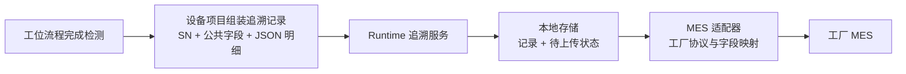

# 第一期开源骨架架构

## 分层

```text
MotionControl.Host.Wpf
  ├─ MotionControl.Framework.Runtime
  ├─ MotionControl.Framework.Wpf
  ├─ MotionControl.Framework.Contracts
  ├─ 一个选定的 MotionControl.Equipment.* 项目
  └─ 所需的 Adapters.* 项目

MotionControl.Framework.Runtime ──> MotionControl.Framework.Contracts
MotionControl.Framework.Wpf     ──> Runtime + Contracts
MotionControl.Equipment.*       ──> Contracts
Adapters.*                     ──> Contracts
```

运行时不引用设备项目或具体厂商实现。设备流程不直接调用厂商 DLL、物理轴号或协议报文。Host 是组合根，负责明确引用当前设备项目和所需适配模块。

## 模块职责

### 可选任务模块：定义、执行、资源和设备级工位调度

`MotionControl.TaskEngine` 作为可选项目依赖 Contracts 和 Runtime，提供任务定义、现有配置只读目录、定义校验和 JSON 保存读取。阶段 2 增加后台执行器，但只接收具体的 `SimulatedTaskDevice` 内存设备。Runtime、现有 C# 工位及 Host 当前均不引用它，现有设备运行链路不变；没有 UI、厂商 SDK 或原生 DLL 依赖。

顺序、独立并行汇合、条件、子任务及内存动作已可执行。定义启动前深复制；运行实例、节点调用快照与定义分离。暂停冻结内存进度并保留相对终点，取消和失败均等待分支清理后发布终态。这些控制语义尚未接入 Host 的复位/启动入口或实际卡。

阶段 3 已加入共享轴、输出和命名区域的整组资源申请。同一个内存设备的多个运行共用具体协调器，独立资源仍可并行；范围内动作及子任务继承占用，进入前和退出前检查显式轴位置/DI/变量条件。正文异常退出保留 Blocked，须显式确认并复核退出条件后放行。请求快照保留运行、任务、节点和等待对象。

通过整组原子申请、禁止嵌套范围和禁止范围内并行，避免先占 A 再申请 B 的资源锁死锁。业务信号互等仍靠节点超时和诊断定位；不自动计算碰撞路径或进行连续安全监控。旧 C# 工位的轴协调器未改动，两套执行入口尚未接入同一实际设备，不能据此允许它们同时操作一台设备。

协调运动仍仅是可校验定义，执行入口在任何动作之前拒绝。后续编辑器将复用任务定义和目录，执行器不从 WPF 控件取值。使用和边界见 `src/MotionControl.TaskEngine/README.md`。

轴组定位已作为明确的 `MoveAxisGroup` 动作接入：同卡多根逻辑轴各自指定目标和工艺速度，一次申请全部轴；使用同一份变量快照解析目标，整组起始检查通过后接受内存动作，各轴独立推进，全部到位才返回。异常/取消先停止本组剩余动作再释放临时资源；在 ResourceScope 中继承占用，异常后由范围保留待确认。它没有统一路径速度，也不承诺同时到达；机械安全动作顺序仍由 Sequence 明确编写。

#### 设备级独立工位决策

参考 UAMP 的 TaskManager 统一管理各任务、TaskBase 独立循环和请求/完成交接，本模块新增具体的 `TaskMachineController`。`Parameters/TaskMachine.json` 保存设备工位清单，工位分别选择 Once、Cyclic 或 OnRequest；可选初始化任务成功后才放行工位。多个工位没有全局周期汇合点，只有工艺明确配置的交接和资源等待。

选择单独的设备入口，而不直接复用硬件 `MachineFlowScheduler`：后者执行现有 C# 的 `IStationFlow`，新入口执行冻结的任务定义，两者当前的动作对象不同。新入口仍只依赖内存设备，Runtime 不反向引用 TaskEngine，也没有新的容器或反射分发。将来接卡时须单独接入厂商无关的运动边界和统一所有权，不能同时启动两套入口控制同一实际设备。

设备入口把暂停、故障和终止分清：Pause 冻结全部运行；Reset 只检查条件、清锁存到 Ready；Start 才继续。受控执行器的故障在当前节点等待，已完成的前置步骤不重放；已接受的运动保存绝对终点，相对位移恢复不叠加。资源范围保留当前阶段，退出条件故障只重查退出。独立单次执行仍保持原失败终态行为。规模超限等执行器终止不能复位续跑。

代价是故障等待保留异步调用进度和当前资源，因此同一会话必须显式 `CloseAsync` 等待收尾；异常终止的区域仍需人工确认恢复。此实现不保存跨进程调用栈或资源占用，不可用变量恢复代替生产检查点。请求握手由明确的两个 bool 变量完成，未知值等待、旧完成先复归；不自动推断信号依赖或业务死锁。

后续 UI 使用清单/任务配置服务及 `GetSnapshot`，不持有工位 TaskRun 控制句柄；复位、启动、暂停通过同一个设备入口调用。快照中整机记录在整机锁内复制，各运行和资源分别读取自己的只读副本，不承诺多个工位与物理采样时刻完全一致。验证记录见 `docs/verification/2026-10-23-task-machine-running.md`。

### 原有模块

- `Framework.Contracts`：运动控制、逻辑 IO、流程生命周期、报警、配置、设备变量、诊断和追溯等稳定边界；具体接口在确认使用场景后逐项定义，避免预先做成一个大型总接口。
- `Framework.Runtime`：默认单机运行上下文；管理工位流程调度、启停暂停、报警处理、配置服务、设备变量运行值和本地追溯队列等通用能力。
- `Framework.Wpf`：通用轴与逻辑 IO 手动调试 UI、设备变量监控与维护页面。框架不预设客户主窗口样式。
- `Host.Wpf`：应用入口、基础主窗口、导航和组合根。后续按客户模板调整。
- `Equipment.*`：逻辑轴/IO 映射、C# 工位流程、设备报警、参数/配方、追溯字段、设备专属页面和手动动作。
- `Adapters.*`：运动卡厂商/型号、Modbus/TCP/自定义通讯、本地存储及 MES 协议的独立实现。
- `MotionControl.VendorApi.*`：厂商原生 P/Invoke 声明。具体驱动适配器引用这些项目并实现通用契约；框架运行时和设备流程不引用它们。

## 第一阶段约定

- 一个 Host 部署选择并引用一个设备项目；不实现运行时热插拔设备项目。
- 每个设备部署由 Host 明确绑定一个设备项目和一种运动卡适配器；设备运行期间不按配置切换厂商适配器，也不扫描目录动态加载。目标是允许一台设备配置一张或多张同一适配器支持的控制器，默认单卡。当前 Runtime 已支持多卡，当前 Host 的连接接口、配置页和正运动接入仍只连接一张卡；在 Host 多卡接入完成前，不能把多张卡配置当作可用功能。
- `HardwareConfig/MotionCards.json` 保存控制卡厂商、卡类型、轴通道数量、本机使用的控制卡标识、适配器名称和连接配置文件；`AxisParameters.json` 保存轴到控制卡/物理轴通道的映射与轴参数；`IoMapping.json` 保存逻辑 IO 到控制卡/物理点位的映射。厂商连接文件只保存该适配器独有的连接参数。
- 通用 WPF 配置页不写死厂商、卡型、轴数或回零模式清单；Host 注入的卡连接实现提供当前部署可选项。回零模式编号按 `AdapterType` 归属并由适配器校验；不能跨适配器复用同一个编号。厂商专属的方向和其他回零参数留在对应适配器配置中。
- 流程按逻辑轴名和逻辑 DI/DO 名调用。DI/DO 名称映射到运动卡或远程 IO 的物理点位；PLC 的 Modbus 点位按带名称和数据类型的协议数据点管理，命令握手逻辑留在设备项目；视觉等设备的自定义 TCP 报文按具体协议组织，不作为普通 IO 点。
- 轴硬件参数与工艺动作参数分开集中管理：轴参数保存通道、工程单位换算、软限位、回零、手动速度和默认运动参数；工艺参数保存命名动作的目标位置与动作速度。
- 默认加减速度由轴参数提供。只有某个工艺动作确实需要不同的加减速度时，才在该动作的工艺参数中覆盖。
- 控制卡清单、轴参数、DI/DO 映射与工艺动作参数分别集中管理，并随设备项目维护：`HardwareConfig/MotionCards.json` 保存控制卡和适配器选择，`AxisParameters.json` 保存轴硬件参数，`IoMapping.json` 保存逻辑 DI/DO 到物理点位的映射，`Parameters/ProcessParameters.json` 保存工艺动作参数。设备项目内的文件作为同型号设备的默认模板。
- 每台已部署的物理设备有唯一 `MachineId` 和独立的生效配置。同型号设备共用程序版本和配置模板，但现场调试后的轴参数、IO 映射、通讯参数和工艺参数各自保存；生效配置放在软件发布目录之外。
- 首次部署时，从默认模板建立该设备的生效配置。软件升级不覆盖生效配置；配置格式变更时先备份，再按版本迁移并验证。
- `Parameters/DeviceVariables.json` 按 `MachineId` 保存现场可维护的变量名称、类型、说明、启动初值和手动写入权限；当前值只在本次运行内存中变化，不与定义配置混存。未初始化的值明确显示“无有效数据”，避免把零值误认成采集结果。
- 流程通过 `IDeviceVariableStore` 按明确类型读写变量；页面在运行、暂停和报警状态锁定人工修改。首期变量类型为布尔、整数、小数和字符串，不使用运行时代码生成或反射来绑定流程变量。
- 设备级调试参数与产品配方分开。产品配方以后可由同型号的多台设备共用；首期不建设中央配置服务器。
- Runtime 统一管理整机状态和启动、暂停、复位命令，并把运行控制协调到各工位；设备项目以 C# 流程步描述各自工艺。多个工位可以并行运行，通过设备定义的请求/完成信号协作。
- 停机报警使整机暂停并保留各工位当前步骤；故障处理并复位后，重新启动时从中断步骤重新进入。非停机报警在触发条件恢复后自动消失，不中断整机流程。
- 急停与普通流程暂停、复位分开处理。Runtime 提供可选的逻辑轴/轴组占用协调，设备流程在需要共享资源的动作前显式申请；机械区域避让、多动子距离和让位顺序仍由设备流程定义。
- 列表式流程编辑器留待未来独立设计。
- 轴和 DI/DO 是基础硬件能力。气缸、真空、夹爪等组合对象由设备项目提供；多个设备确认共性后再抽成可选模块。
- SN 是产品追溯的主要关联键。设备项目定义采集字段；运行时先保存生产记录，再交给本地持久化的待上传队列；MES 适配器处理工厂协议与字段映射。记录包含稳定的公共字段，新增检测项放入带版本的 JSON 明细，避免每增加一项就改数据库列。
- 停机报警与非停机报警由运行时统一管理；设备项目定义具体报警。急停链路与普通流程暂停/复位分开处理。

### 架构决策记录：IO 与设备通讯边界

**背景：** 参考工程 UAMP 与 Leadshine POL 都把 DI/DO 作为具名配置点，再关联到板卡、模块或通道。HLAMotion 的 PLC 联机部分把寄存器定义为带名称、数据类型和地址的数据项，并由独立服务处理命令上升沿、心跳和整机状态反馈。UAMP 的 PDCA TCP 收发代码则放在项目通讯目录，使用自己的发送队列和收发逻辑，与 IO 点位分开。

**决策：** DI/DO 在流程中使用容易理解的逻辑名称，物理点位集中保存在设备的 `HardwareConfig/IoMapping.json`。PLC 通讯使用具名、带数据类型的 PLC 数据点；Modbus 适配器负责读写，设备项目负责点位含义和命令/应答握手。视觉等设备的 TCP 交互由设备项目中的协议代码负责，公共通讯适配器只提供连接和基础传输能力。

**配置与错误处理：** IO 映射、PLC 地址和通讯参数随设备实例保存，设备项目提供默认模板。启动时检查名称重复、点位缺失、数据类型不匹配和地址配置错误，并通过诊断信息报告；流程不应把“点位未找到”当成普通的 `false` 状态继续执行。参考 UAMP 的名称查找方式值得沿用，但该工程在未找到名称时通过弹窗提示并返回 `false`，框架应改为可定位的配置诊断。

**影响：** 轴与 DI/DO 的硬件抽象保持直白；PLC 具有寄存器类型和握手语义，视觉 TCP 具有报文与请求/应答语义，各自留在合适的模块中。首期不建设统一的万能通讯点位或运行时协议扫描机制。

### 架构决策记录：生产追溯记录与 MES 上传

**背景：** 参考 UAMP 的测试记录含 SN、结果、起止时间和多条检测明细，并把上传任务放到后台处理。其上传实现按项目名称分支组装字段和报文，队列由 UI 页面持有且只存在内存中；进程退出或断电时，待上传数据无法依靠该队列恢复。

**决策：** 设备项目负责从工艺结果构建追溯记录，公共记录至少包含记录 ID、`MachineId`、SN、工位、开始/结束时间和整机结果，设备检测明细放入 JSON 载荷并带载荷版本。SN 是跨设备和工位查询产品的主追溯键；记录 ID 用于区分同一 SN 的不同工位记录或返修记录，并在上传重试时保持不变。

运行时在生产记录完成后先将记录和待上传状态写入本地存储，再异步交给 MES 适配器。网络中断或服务拒绝时，记录留在待处理队列中并保留最近上传结果；进程重启后可继续处理。存储适配器负责本地记录与持久队列，MES 适配器负责指定工厂/项目的报文、字段映射和应答规则，设备流程不拼接 MES 报文。

**JSON 的范围：** JSON 明细可容纳设备特有或后续新增的数据项，避免数据库表结构频繁变更；它不负责产生数据。新增采集项仍须有对应的传感器、设备通讯值或工艺计算值，并由设备项目接入。MES 字段变化由相应适配器映射处理。

**影响：** 设备数据采集、数据库保存和工厂上传协议分别归属 Equipment、Storage 和 MES 模块。首期不把所有项目的字段强行固定成同一组数据库列，也不让内存队列成为生产数据的唯一副本。具体数据库产品、上传重试间隔和保留期限随首个设备项目再确定。



### 架构决策记录：运动参数归属

**背景：** 参考工程中既有按轴统一保存自动速度的做法，也有把速度、停止速度或加减速比例放在工艺点位中的做法。单一轴默认速度简单，但不能覆盖同一轴在不同工艺动作中的速度差异；把数值直接写在流程调用里又不利于集中调试。

**决策：** 硬件与轴级参数归轴参数管理，动作目标位置和动作速度归设备工艺参数管理。轴加减速度先作为默认值；工艺确有需要时可以按动作覆盖。参数使用有明确名称的设备配置，流程代码通过名称读取，不散落无说明的速度常量。

**影响：** 轴调试配置与设备工艺调参有清楚的归属；同一轴可用于不同速度的动作，流程仍按步骤顺序表达。首期不增加通用运动配置编辑器或复杂运动配置抽象。

**保存方式：** 设备项目中的 JSON 文件是默认模板；运行时为每个物理设备创建独立的生效 JSON 配置，存放在软件发布目录之外。轴参数和工艺参数分别保存，避免硬件调试参数与工艺调参混在同一份配置里。升级时保留设备配置，并在需要时备份、迁移和验证。

### 架构决策记录：同型号设备的配置管理

**背景：** 多台同型号设备共用一份程序和配置模板，但安装后的轴参数、IO 地址和工艺参数会因现场调试而不同；软件升级时不能把这些现场值覆盖掉。

**决策：** Equipment 项目随程序提供 JSON 默认模板；每台物理设备用唯一 `MachineId` 保存自己的生效配置，配置目录放在软件安装目录之外。首次部署时从模板建立配置；升级时保留生效配置，格式变化则先备份，再按版本迁移和校验。轴/硬件参数、IO 映射、工艺参数和产品配方分别管理；配方不混入设备调试参数。Runtime 的 Configuration 提供按 `MachineId` 复制模板、读取 JSON、检查 `schemaVersion` 和带备份的原子保存；具体参数校验和版本转换由设备项目按明确版本实现，Host 负责选择本次部署的 Equipment 与适配器。

**影响：** 同型号设备可共用程序版本而保留各自现场值。首期不建设中央配置服务；运行中的设备只使用当前 MachineId 对应的配置，不通过修改模板影响其他设备。

### 架构决策记录：运动卡适配器选择

**决策：** 一个设备部署由 Host 显式引用一种运动卡适配器。卡号、连接地址、轴号和轴参数保存在该设备实例的配置中；适配器厂商与型号实现由 Host 的组合入口确定。首期不做运行时厂商切换、反射扫描或目录插件加载。

**影响：** 更换控制卡适配器时，只调整 Host 组合入口并重新部署；设备工艺流程继续使用逻辑轴契约，不随厂商 API 改写。Runtime 的 `MotionCardGroup` 可管理多张已创建的卡实例；当前 Host 尚未提供多卡配置和连接入口，因此当前可运行的 Host 只支持一张控制器。后续实现 Host 多卡能力前，需明确各卡是否限定为同一种适配器。

### 架构决策记录：运动卡共用能力与厂商边界

**参考工程观察：** `Leadshine.CNC.POL_V2.2.05-20210929` 将 DMC5610 和 DMC5410 分别放在 `PolMotionA`、`PolMotionB` 中，并使用各自的运动参数集合；卡的轴状态、IO 和运动事件由上层运动管理代码统一处理。`版本库_202400613-V1.0.1.7_修改真空检测_恢复版` 的 `IMotionCard` 同时包含轴状态、位置、停止、多轴/坐标和触发等大量能力；`PrimLESI` 则在具体实现中调用 `LTDMC.dmc_*`，自行完成单位换算和回零参数下发，其中也能看到尚未实现的方法。两种做法说明基础轴动作可以统一，但不能据此假定同一厂商的所有卡型都有相同 API 和能力。

**决策：** `Framework.Contracts` 只保留设备流程普遍需要、且能够定义一致语义的基础能力：卡连接、逻辑轴状态、伺服使能、绝对/相对移动、点动、普通停止、回零、轴报警复位，以及逻辑 DI/DO 读写。设备流程只使用逻辑轴名、逻辑 IO 名和工程单位。厂商 API、物理轴/IO 通道、脉冲当量、信号极性、厂商回零模式、状态位解析、停止方式映射和厂商错误码全部留在具体适配器及其硬件配置中。

适配器的划分依据是实际 SDK/API 家族及其行为，不只看厂商名称。同一厂商、多个型号若确实使用相同 SDK 且基础语义一致，可以共用适配器；脉冲卡与总线卡若使用不同 SDK、配置过程或状态语义，应分开实现，不因属于同一厂商而强行共用驱动。Host 继续显式选择适配器；换卡时替换 Host 组合和该设备的卡、轴、IO 配置，工艺流程应保持不变。

**扩展规则：** 多轴插补、电子凸轮、电子齿轮、位置比较触发、控制器脚本等能力不加入所有卡必须实现的基础接口。只有实际设备流程需要、且目标卡确实支持时，再为该项建立小而明确的可选能力接口或厂商专属服务。适配器遇到不支持的操作必须给出清晰错误，不能返回假成功或用默认值伪装支持。

**语义与诊断：** 适配器负责保证公共方法的完成、取消和停止语义符合 Contracts；回零方法使用设备配置，不把厂商整数模式号传入工艺流程。公共状态与能力字段只表达框架约定的状态、数量和可读诊断，不暴露可供通用逻辑分支的厂商错误码数值。厂商原始状态位、历史停止原因和错误码由适配器解析或写入诊断说明，流程不得依赖这些数值分支；诊断说明应保留现场定位所需的厂商接口名和错误码。

**适配器验收边界：** 新适配器逐项验证连接和断开、轴状态映射、伺服使能、正负方向运动与停止、绝对/相对定位、回零完成与超时、硬限位恢复和报警复位、DI/DO 逻辑映射及极性。仿真器结果记录为仿真器验证；没有仿真器时，相应项目标记为未验证，不能由 API 声明推断通过。

**当前状态：** 框架已有正运动 ZDevelop 仿真适配器，雷赛项目目前只有 `MotionControl.VendorApi.Leadshine` 原生 API 声明，没有实现并验证雷赛适配器。该边界为后续接入雷赛以及其他厂商/卡型预留了位置，但不代表雷赛已可直接切换运行。

### 架构决策记录：整机状态与工位流程

**背景：** 参考工程采用整机状态入口协调运行命令，同时把工位或子任务的流程步分开维护。这与本框架需要的并行工位和全机级启停控制相符。

**决策：** Runtime 持有整机运行状态，集中处理复位、启动、暂停、停机报警及恢复，并协调各工位流程。设备项目按工艺功能编写独立的 C# 工位流程，各自保存当前步骤；工位之间通过明确的请求/完成信号协作。停机报警时暂停整机并保留步骤，复位后再次启动从中断步骤重新进入；非停机报警条件恢复后自动清除。

**影响：** 整机状态转换规则集中在一处，工艺动作仍能按工位和步骤直接阅读。共享轴可通过可选的占用凭证避免并行工位同时使用；设备工艺判断运动区域、让位条件和安全位置，Runtime 不推断空间关系。

### 架构决策记录：多卡连接与工位步骤调度

**运动卡连接：** 多卡目标由 Host 显式创建设备所需的运动卡实例，Runtime 的 `MotionCardGroup` 校验控制卡标识和逻辑轴名称，并按配置顺序连接。连接中途失败时，Runtime 回收本次已连接的卡，同时保留原始驱动错误；设备流程通过逻辑轴名称取轴对象。当前 Host 仍只创建并连接一张正运动仿真卡；`MotionCards.json` 的列表结构和 Runtime 多卡能力不代表 Host 多卡接入已经完成。

**工位流程：** 每个设备工位实现 `IStationFlow.ExecuteCurrentStepAsync`，由工位类保存当前步骤并用 `switch` 分派。步骤使用显式编号和中文说明；转步时同时更新编号与说明，条件分支直接指定各自目标编号，不依赖步骤数组顺序。步骤只有动作完成后才能前进；需要独立显示、等待、超时、报警处理或恢复的工艺边界拆成单独步骤，固定且可复用的短动作封装为方法。设备初始化和工位流程都由 Runtime 在后台执行，设备流程不直接访问 WPF 控件。暂停通过取消当前步骤并等待所有工位退出；轴移动对取消执行受控停止，工位保留当前步骤。复位清除可复位报警但不推进步骤；必须复位成功后才能再次启动。当前步骤保存在进程内存中，Host 重启后的断点续跑不在首期范围内。

### 架构决策记录：共享轴与轴组占用

**背景：** 参考 UAMP 的 `MotionManager` 用按物理轴通道记录的忙闲状态保护单轴和轴组，并在运动调用的 `finally` 中释放；POL 更多在工艺流程中判断当前位置、先执行避让，再按顺序移动。两种方式分别覆盖资源互斥和机械空间避让。

**决策：** `MotionCardGroup.AxisResources` 向设备流程提供本机共享的 `IAxisResourceCoordinator`。流程需要独占一个或多个轴时，按逻辑轴名称调用 `AcquireAxisAsync` 或 `AcquireAxisGroupAsync`，并在相关动作停稳后释放返回的 `IDisposable` 占用凭证。轴组按固定名称顺序申请，等待支持取消；取消中途发生时自动释放已申请的轴。没有共享轴的设备可以不使用该能力。

**设备流程责任：** 占用协调只防止同时访问同一逻辑轴，不判断轴间距离、机械手区域或多动子碰撞。设备流程仍需显式编写请求/完成、避让条件、安全位置和动作顺序，并在持续点动等动作完全停止后才释放凭证。持有凭证期间不要嵌套申请其他资源；涉及多轴的动作应一次申请完整轴组，避免并行流程各持有部分轴资源后互相等待。没有申请协调器的动作不受它保护。

**影响：** 资源键使用逻辑轴名，不暴露厂商 API 或物理通道；调用方式可以在不同厂商适配器间复用。协调器不自动包裹所有运动命令，也不接管整机流程或工艺互锁，便于工程师从工位当前步骤直接看到资源申请和释放范围。

### 架构决策记录：单机设备变量

**参考观察：** UAMP 的参数页面支持名称、类型、说明和值编辑，并将参数保存为运行时生成的程序集；其设备流程另有静态 `GlobalVar` 保存过程值。POL 按模块保存强类型配置，Lemax 的部分全局量则是代码中的静态字段。以上做法说明现场参数编辑和流程运行值都有实际用途，但动态生成程序集会增加部署、调试和类型定位成本。

**决策：** 变量定义保存在每台设备自己的 JSON 配置中，Runtime 使用简单的线程安全类型化变量表保存当前运行值；设备流程直接使用 `Get/SetBoolean`、`Get/SetNumber` 等明确方法。当前值变化通过事件刷新监控页，未写入的值显示为无效数据。JSON 新增字段可在设备量产后按设备目录扩展，配置保存沿用现有带备份写入。

**边界：** 页面服务于单台设备内部的运行与调试，不替代产品配方、追溯记录、MES 字段或跨设备通信。变量初值随定义配置保存；流程运行时更新、现场手动写入和采集结果不自动写入配置或数据库。流程运行、暂停或报警期间，页面锁定定义和手动写值。后续若出现更细的权限、变量来源绑定或采集持久化需求，再按实际现场要求扩展。

**状态入口：** 第一版 Runtime 状态为 `Disconnected`、`ResetRequired`、`Ready`、`Running`、`Pausing`、`Paused`、`Alarmed`。未处理的工位异常按停机故障处理，Runtime 请求其他工位暂停并保留异常。设备项目用 `MachineAlarmDefinition` 标记停机或非停机报警，并用条件状态报告报警：非停机报警在条件恢复时自动清除；停机报警在条件恢复后仍保留，整机复位时清除，条件仍成立时拒绝复位。停机报警触发后，Runtime 请求所有工位退出当前步骤并等待受控停止。急停安全回路仍需独立接入，不由普通报警和流程暂停代替。

### 架构决策记录：任务入口与工位流程入口互斥

**背景：** 框架同时存在两条可以驱动设备的执行路径：设备工程里用 C# 编写的 `IStationFlow` 工位流程，和图形化的任务定义（TaskEngine）。两条路径都能读逻辑轴、写 DO、报告警。若同时投入运行，会出现两套调度同时命令同一批轴、暂停语义互相覆盖、报警归属不清的问题。本项目既要保留已经验证过的 C# 工艺代码，又要发展任务配置能力，因此需要明确的选择机制，而不是靠"不要同时用"的隐含约定。

**决策：** 两者并存，由 Runtime 的单一"执行入口"仲裁，同一时刻只允许一个入口启动设备。执行入口取值为 `MachineControlOwner.None`、`StationFlows`、`TaskEngine`。Runtime 在构造时按是否配置 C# 工位流程决定入口：配置了工位流程即为 `StationFlows`，没有则为 `None`。任务入口必须显式调用 `AcquireTaskEngineControlAsync` 接管；已有 C# 工位流程、或设备处于运行与暂停处理中时拒绝接管并说明原因。`StartAsync` 只在入口为 `StationFlows` 时允许启动，其他入口一律拒绝并给出当前入口。

**影响：**

- 切换执行入口是配置级动作，不是运行中热切换：需先停用 C# 工位流程，再让任务入口接管，避免运行中两套调度争抢同一批轴。
- 入口归属集中在 `MachineRuntime`，工位流程和任务执行器都不必各自判断"另一个入口是否在跑"，避免判断逻辑分散。
- 手动调试不受入口影响：连接、伺服使能、点动、DO 手动仍按原规则可用。
- 任务执行器通过 `ITaskDevice` 接入真实设备尚未实现，因此当前配置了工位流程的设备只能使用工位流程入口；该抽象完成后，接管路径才真正具备可用的设备侧实现。

## 目录约定

```text
src/
├─ MotionControl.Framework.Contracts/
│  ├─ Configuration/       配置加载与校验的最小契约
│  └─ Traceability/        追溯记录与存储/上传边界
├─ MotionControl.Framework.Runtime/
│  ├─ Configuration/      设备配置加载、版本迁移与校验
│  └─ Traceability/        记录落库与待上传处理
├─ MotionControl.Framework.Wpf/
├─ MotionControl.Host.Wpf/
├─ MotionControl.Equipment.Template/
│  ├─ HardwareConfig/      轴参数、逻辑 DI/DO 到物理点位的映射
│  ├─ Communications/      设备专属 PLC 点位/握手与自定义设备协议
│  ├─ Parameters/          工艺动作参数模板与产品配方
│  └─ TraceData/           设备追溯字段与生产记录组装
└─ Adapters/
   ├─ Communications/     可复用的 Modbus、TCP 等协议传输实现
   ├─ Mes/                 工厂/项目 MES 协议适配
   ├─ MotionCards/         厂商运动卡驱动适配
   └─ Storage/             本地记录与持久化待上传队列
```

运动卡目录已按厂商接入雷赛、正运动、ADLINK 原生 API 项目。正运动增加了仅限 `127.0.0.1` 的 ZDevelop 仿真适配器，并在连接后核对 `VPLC5xx-Simu` 身份；该适配器不支持实体控制卡。ZDevelop 仿真样例将连接参数、轴参数和 IO 映射分别放在独立 JSON 文件中，供联调工具组合成同一张卡实例。雷赛和 ADLINK 的驱动适配器及原生 DLL 部署仍待实现。设备模板项目包含控制卡清单、轴参数、IO 映射、流程、报警、参数、追溯、手动操作和页面等目录，供新设备项目复制。
