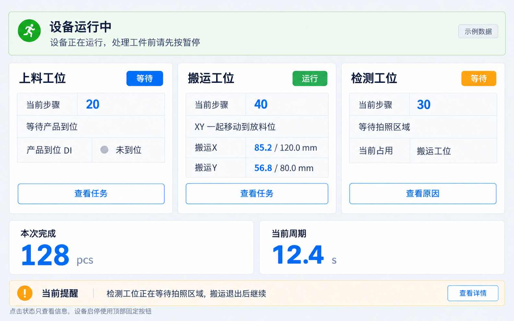
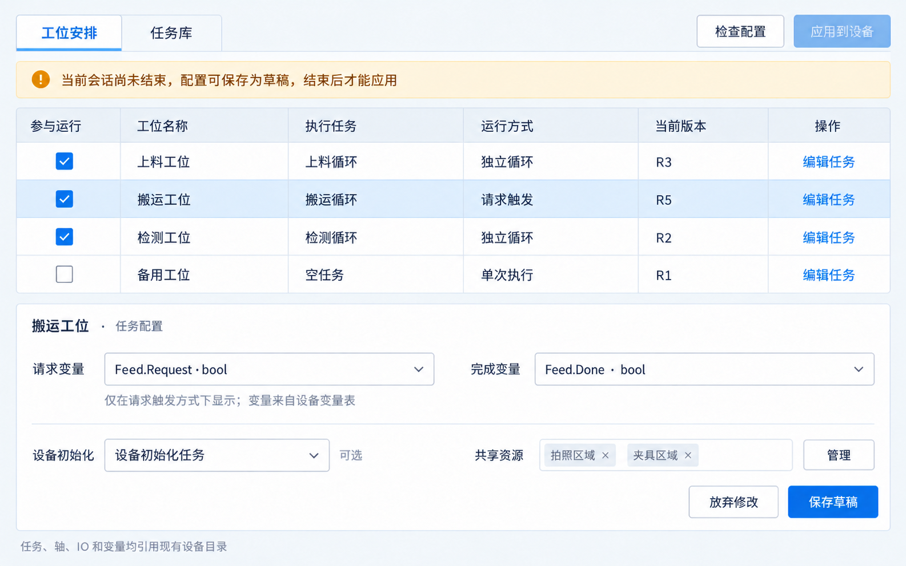
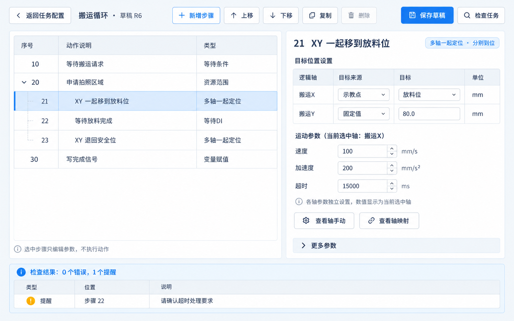
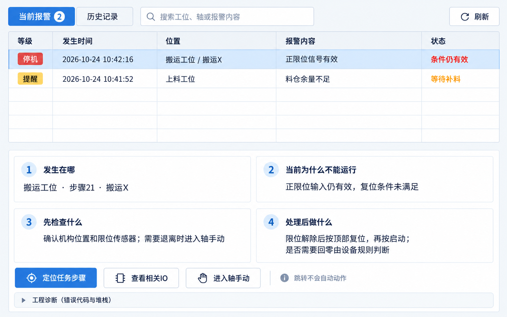

# 运动控制上位机 UI 交互设计讨论稿 V1

日期：2026-10-24；代码基线：348f8c3。

设计讨论稿。新增界面均为建议；本轮未修改任何 C# 或 XAML 文件。

## 01  通用运动控制上位机

状态：图文讨论稿。UI 交互设计讨论稿 V1  ·  保留现有布局，补齐操作闭环

操作员看状态、找原因、恢复生产。
调试人员按列表编排任务，按步骤填写参数。
已完成的轴、IO、变量页面继续负责原来的功能。

本册包含四张 AI 工作区概念稿，以及现有布局、步骤表单、等待诊断和恢复对话框示意。所有图片均为设计示例，不代表已连接设备。

本轮只做设计讨论和文档交付。已有页面的基本布局保持不动；新增页面、权限和任务真实执行接入须按后续阶段逐项落地。

## 02  01  先把交互原则说清楚

状态：推荐方案与边界。复杂性留在明确的功能模块里，页面先回答“现在怎样、卡在哪里、下一步做什么”。

现有顶部导航、左侧菜单、状态栏和启停按钮位置保留。新增页优先使用表格、选中行详情和少量对话框；常用操作可见，高级参数折叠。

流程图拖拽：分支和连线容易占满现场屏幕。
全部功能集中一张大表：轴、IO、变量与流程容易混在一起。
列表方案能直接显示步号、动作和当前等待，代码也更容易对应。

| 必须分清 | 当前代码事实 | 本册建议 |
| --- | --- | --- |
| 控制方式 | Host 的传统 Runtime 与新任务内存会话目前分开。 | 每台设备明确选择运行入口；完成接入前不把内存值显示为生产值。 |
| 已实现 / 新设计 | 已有九类功能页或入口；部分导航仍是占位。 | 逐页标注现状；新增界面不代表本轮已开发。 |
| 图像来源 | Windows 页面观察初始化两次失败：failed to write kernel assets（os error 3）。 | 旧布局示意依据 XAML 绘制；四张新增页为 AI 概念稿，均非软件运行截图。 |
| 范围 | 当前重点是单台设备、单张运动卡。 | MES、Modbus/TCP、单机多卡和整线调度留待后续。 |

## 03  02  已有页面：保留布局与职责

状态：现有代码证据。“有导航名称”不等于该页面已完成；以下来自当前 Host 组合代码与实际 XAML。

| 现有页面 / 入口 | 已承担的职责 | 后续怎样与新页衔接 |
| --- | --- | --- |
| 轴映射配置 | 连接、逻辑轴映射、轴参数等工程配置。 | 任务按逻辑轴选择；缺少轴时跳回此页定位。 |
| 轴手动 | 轴卡片、手动操作与示教位置。 | 任务选示教点；跳转时定位轴，动作仍在原页操作。 |
| IO 映射 | 逻辑 DI/DO、通道和有效极性。 | 任务选择逻辑名称，不重复输入物理地址和极性。 |
| IO 手动 / IO 监控 | 手动输出与 IO 状态观察，各自已有页面。 | 详情区提供查看入口；页面跳转本身不写输出。 |
| 设备变量 | 定义、类型、当前值、写入与时间；支持恢复记录。 | 参数下拉复用名称和类型；运行数据来源须明确。 |
| 安全联锁 | 设备级软件联锁配置。 | 保留职责；资源占用与联锁不能互相替代。 |
| 流程状态 | 传统 C# 工位当前步骤、报警和错误显示。 | 保留，服务现有传统流程。 |
| 任务运行 | 工位表 + 步骤树 + 分类详情；当前为独立内存仿真。 | 保留基本布局；等待原因通过详情窗口补充。 |
| 首页 / 独立报警 / 用户等 | 导航已列出；首页与独立报警等尚未接入完整业务页。 | 本册设计首页和当前报警；权限界面仍须单独实现。 |

“旧页面不改动”指本轮不重排已完成页面、控件与外壳。后续新增跳转入口若需要修改旧页，也只做最小定位接入，并另行确认。

## 04  03  日常操作只走三条主路径

状态：设计建议。角色区分是后续设计建议；当前 Host 的用户权限页面仍为占位，不能当作已落实的权限控制。

设备总览
看整机状态和各工位当前动作。
出现异常时进入当前报警。

任务运行、轴手动、IO 手动、设备变量。
根据报警定位对象并处理。

任务配置、任务编辑、硬件映射与联锁。
管理运行版本和恢复边界。

建议仅在“设置”下增加“任务配置”入口。任务编辑从选中任务进入；步骤选择、资源诊断、重启恢复均为上下文对话框，不各占一个主菜单。

## 05  04  现有外壳：位置保持不动

状态：保留现有布局。依据 MainWindow.xaml 的结构示意。实际样式继续沿用现有实现，本图不是运行截图。

1  顶部启停按钮固定，不在新页重复放同义按钮。

2  左侧保留当前功能分组，新增入口控制数量。

3  表格滚动只发生在内容区，不能把操作栏卷走。

4  时间使用 yyyy-MM-dd HH:mm:ss；语言变化不改对象标识。

保留外壳并不妨碍简化操作：让默认首页和报警页直接给出下一步，避免操作员在工程配置里寻找答案。

## 06  05  新增：设备总览

状态：设计建议。入口：首页 → 设备总览。当前为占位区，本设计填入内容，不改变外壳。

整机状态、下一步提示、工位卡片、当前动作、关键等待和本次完成数。

点“查看任务”定位工位；点“查看原因”打开等待详情。启停仍用顶部按钮。

整机暂停时，卡片标“已暂停”；保留暂停前动作文字，但不能仍显示“运行”。

数据必须来自当前被选定的实际运行入口。未连接、读取过期、无任务分别显示；没有数据时显示“未读取”，不能拿 0 或“正常”填充。工位多时按设备配置顺序滚动，不固定只支持三工位。

## 07  06  已有：任务运行页继续保留

状态：现有布局 + 局部补充。沿用工位表在上、步骤树在左下、分类详情在右下的布局；此图是按现有 XAML 绘制的结构示意。

| 工位 | 状态 | 当前动作 / 等待 |
| --- | --- | --- |
| 上料 | 等待 | 产品到位 DI 未满足 |
| 搬运 | 运行 | XY 到放料位 |
| 检测 | 等待 | 拍照区域被搬运占用 |

选中工位后，树和详情一起变化。点击故障定位原步骤；返回后保留原选中行和滚动位置。

任务、轴和变量目录可读取现有配置；位置、IO、变量运行值目前仍来自独立内存设备。真实运行接入尚未完成。

建议增加的“查看等待原因”只打开诊断窗口；现有采样要标明时间与历史属性。完成步骤的采样不能冒充最新现场值。当前 Host 顶部按钮控制传统 Runtime，仿真窗口按钮控制内存会话；统一前须保留明确来源提示。

## 08  07  新增：任务配置 / 工位安排

状态：设计建议。入口：设置 → 任务配置。一个页面容纳“工位安排”和“任务库”两个页签。

参与运行、工位名称、执行任务、运行方式和版本；初始化任务与共享资源。

单次/独立循环不显示握手字段；请求触发才显示两个 bool 变量选择框。

运行会话冻结原清单。改动先存草稿；结束会话且停稳后才能检查并应用。

第一版不做复杂任务依赖图。工位各自循环或等待请求，设备启动不等待其他工位完成一轮。改变启用项也属于配置变更，不能让运行中的工位突然消失。命名资源来自 TaskMachine 清单，不从任务文字自动推断。

## 09  08  新增页签：任务库与版本使用

状态：设计建议。入口：任务配置 → 任务库。仅管理列表任务；传统 C# 工位代码继续由工程师在代码中维护。

| 任务名称 | 稳定标识 | 设备在用 | 草稿状态 | 操作 |
| --- | --- | --- | --- | --- |
| 搬运循环 | Transfer | R5 | R6 未检查 | 编辑 / 查看引用 |
| 上料循环 | Load | R3 | 无修改 | 编辑 / 查看引用 |
| 拍照子任务 | Camera | R2 | R3 检查通过 | 编辑 / 查看引用 |

| 操作 | 具体处理 |
| --- | --- |
| 保存草稿 | 建议存 Drafts/Tasks 和 Drafts/TaskMachine.json，不替换运行定义；复用任务结构，草稿存储尚未实现。 |
| 检查任务 | 检查轴/IO/变量/点位引用、范围、时限、子任务循环和资源遗漏；点击错误定位步骤。 |
| 应用到设备 | 确认影响工位和修订号；结束旧会话、确认停稳后保存运行文件。失败保留原文件。 |
| 删除 / 复制 | 在用或被子任务引用时禁止删除并显示引用位置；复制生成新任务/节点 ID，移动保持原 ID。 |

## 10  09  新增：列表式任务编辑

状态：设计建议。入口：选中任务 → 编辑。第一版用按钮新增、移动和复制步骤，拖拽仅作为以后可选快捷方式。

步号、中文动作、类型。容器展开显示子步骤，选中行始终明显。

只显示当前步骤需要的字段；轴、IO、变量均从已有目录选择。

检查结果定位到具体步骤和字段；未保存标记保留，离开时只询问一次。

显示步号供阅读，稳定节点 ID 用于保存和诊断；重新排序不生成新 ID。选中、展开、复制、检查和保存都不会执行设备动作。首版提供内存验证入口；真实“试跑一步”须另做资源、联锁和运动验证。

## 11  10  新增对话框：选择步骤类型

状态：设计建议。点“新增步骤”后选择；常用类型在前，能力尚未接通的类型显示原因。

| 建议名称 | 对应现有模型 / 限制 |
| --- | --- |
| 单轴 / 多轴一起定位 | MoveAxis / MoveAxisGroup；后者独立到位。 |
| 回零 / 停轴 | AxisCommand；回零参数来自现有轴配置。 |
| 等待 DI / 设置 DO | WaitInput / SetOutput；不提供隐藏输出脉冲。 |
| 变量 / 延时 / 等待条件 | SetVariable / Delay / WaitCondition。 |
| 顺序 / 并行 / 分支 | Sequence / ParallelGroup / ConditionBranch。 |
| 子任务 / 资源范围 | CallTask / ResourceScope。 |
| 直线插补 | CoordinatedMove 仅有定义；当前执行未接入，应禁用。 |

“多轴一起定位”不等于直线插补，也不保证同时到达；界面持续显示此语义。当前没有通用条件循环节点；重复生产先用工位独立循环，不能把任意 while 脚本塞进编辑器。

## 12  11  运动类详情：字段跟着类型变化

状态：设计建议。示意表单；不新增第二份轴映射、回零参数或示教点文件。

| 轴 | 方式 | 目标 | 速度 |
| --- | --- | --- | --- |
| 搬运X | 绝对 | P001 | 100 |
| 搬运Y | 绝对 | 80.0 | 80 |

选中一根轴后，显示它自己的速度、加速度和减速度。整组只有一个超时；全部轴到位后进入下一步。

不承诺直线路径或同时到达。

| 场景 | 界面规则 |
| --- | --- |
| 相对移动 | 字段改叫“移动距离”；只用固定值或数值变量，不把绝对示教点当距离。 |
| 回零 | 只选择逻辑轴并显示回零方案摘要；厂商模式编号和信号极性继续留在原轴配置/适配器。 |
| 参数来源 | 自动动作速度来自任务工艺参数；原轴手动速度不自动成为生产速度。动作接受后记录实际终点。 |

## 13  12  IO 与变量详情：只选逻辑对象

状态：设计建议。所有“预览当前值”都是只读；真正执行只由任务执行入口处理。

选项必须明确填写。极性由 IO 映射处理，任务不填 0/1 电平。

显示 bool、int、double、uint 等类型名，并按现有类型校验。

| 交互问题 | 明确处理 |
| --- | --- |
| 未知 DI | 未知、无效和有效是三个状态；未知不能作为 false 悄悄放行。 |
| 输出脉冲 | 现有无独立脉冲节点；用“设置有效 → 延时 → 设置无效”显式编排，并检查退出行为。 |
| 变量修改 | 编辑任务只改定义；原变量页手动写值沿用确认、类型范围和权限检查。 |
| 离开与返回 | 查看映射/变量后返回原任务、原步骤与未保存内容；不自动把临时预览写回任务。 |

## 14  13  条件分支：用句子和表格表达

状态：设计建议。“判断一次走哪边”和“等到条件成立再继续”使用相似字段，但行为必须区分。

| 左值 | 比较 | 右值 |
| --- | --- | --- |
| Vision.OK · bool | 等于 | true |
| Product.Count · uint | 大于 | 0 |

条件分支进入时采样并确定路径；历史判断留存。等待条件会保持当前步直到成立或超时。界面不能让人以为分支会不断重新选择。

数值可比较大小，bool/string 用合适操作符。组合提供全部成立、任一成立和取反；复杂组合折叠成子条件，不要求写 C#。

无效变量不能直接走“不成立”分支。检查错误定位到该条件；执行时无效值按现有执行器规则报错。第一版不开放用户脚本、反射方法名或任意 SDK 函数选择。

## 15  14  并行与避让：把关系展示清楚

状态：设计建议。不把“锁住同一轴”说成“已经解决碰撞”。机械区域、坐标和退让条件仍由设备工程确定。

| 字段 / 状态 | 具体规则 |
| --- | --- |
| 并行分支 | 显示缩进分支名和各自状态；不限制整机一次只能执行一个步骤。汇合等待全部完成。 |
| 资源范围 | 选择目录里的资源；范围包含该段实际使用的全部轴和 DO，以及子任务的资源。 |
| 进入 / 退出条件 | 进入条件用于开工前核对；退出条件用于确认让出。它们不等于持续防碰撞监控。 |
| 异常待确认 | 区域内异常时可保留占用并显示原因；复位不能悄悄强制释放。 |

## 16  15  新增对话框：为什么一直在等

状态：设计建议。从首页“查看原因”或任务详情进入。诊断使用现场名称，工程编号按需展开。

| 对象 | 当前信息 |
| --- | --- |
| 等待工位 | 检测工位 · 步骤 30 |
| 当前持有人 | 搬运工位 · 步骤 20 |
| 释放要求 | 搬运X、搬运Y 退出区域并满足退出条件 |
| 当前状态 | 正常等待；已等待 2.3 s |

一键跳到持有工位的当前步骤；从相关轴进入现有手动页。返回时保持原等待步骤。

若状态为“待确认”，展示阻塞来源与未满足条件。工程恢复需核实位置和退出条件，并记录处理说明；普通操作员没有强制释放按钮。

等待不等于报警。正常排队用蓝色；达到设置时限或出现异常再用相应状态。数据过期或持有人未知时显示“状态未确认”，不能显示“区域空闲”。该对话框只读取状态，不发运动指令。

## 17  16  新增：当前报警与处理指导

状态：设计建议。入口：报警 → 当前报警。已有流程状态页中的报警摘要继续保留。

发生在哪、为什么不能运行、先检查什么、处理后做什么。

定位任务步骤、查看相关 IO、进入现有轴手动；返回后仍选中原报警。

停机报警条件解除后仍需复位；非停机提醒按设备规则随条件恢复消失。

停机报警一般暂停整机，保留当前流程位置；“确认已读”不能等同于解除报警。厂商代码、停止原因和异常堆栈放工程诊断折叠区。限位恢复与重新回零要求遵守已有 Runtime/适配器规则，不由页面自行判断。

## 18  17  新增对话框：软件重启后的恢复说明

状态：设计建议。目标是让操作员清楚知道恢复了什么、还缺哪项确认；不是每次重启强制全机回零。

| 检查项 | 结果 |
| --- | --- |
| 设备变量名称和类型 | 匹配，原有效值已恢复 |
| 工位步骤 / 配置版本 | 匹配，保存于暂停边界 |
| 控制卡当前连接和轴状态 | 正在重新核对 |
| 轴参考、工件和区域状态 | 待确认，不允许直接启动 |

传统 Host 有变量、可恢复工位步骤和初始化完成记录；会检查配置签名和变量类型。是否可恢复有明确原因提示。

新 TaskEngine 目前仅进程内暂停/恢复，尚无跨进程执行检查点。不能把传统恢复文件直接套到任务调用树；此部分要另开实现阶段。

恢复业务变量不等于恢复现场 IO；DO 不能按 JSON 自动回放。断电、重新连接、轴参考丢失或工件被移动时，按设备恢复规则重新检查；无法证明可续跑时给出具体原因，再由工程人员安排初始化。确认后仍按“复位 → 启动”。

## 19  18  数据与页面关联：只维护一份来源

状态：设计建议。任务页引用对象；原轴、IO、变量页面继续管理定义和手动动作。

| 任务页需要什么 | 复用的现有来源 | 交互与禁止重复 |
| --- | --- | --- |
| 逻辑轴 / 单位 / 行程 | HardwareConfig/AxisParameters.json | 下拉选轴；映射页按名称定位。任务不填卡号、通道或脉冲当量。 |
| 示教点 | Parameters/ManualAxisPositions.json | 按逻辑轴和 PointId 关联；显示名称可变，不以名字代替稳定 ID。 |
| 逻辑 DI / DO | HardwareConfig/IoMapping.json | 按方向筛选；极性只由映射/适配器处理，不能在步骤里再取反一次。 |
| 设备变量名称 / 类型 | Parameters/DeviceVariables.json | 按用途筛选数值、bool 或 string 等；类型沿用已有定义。 |
| 任务与工位安排 | Tasks/*.json + Parameters/TaskMachine.json | 任务正文、工位引用和命名资源分清楚；运行中的定义保持冻结。 |
| 当前值 / 执行记录 | 实际执行入口的状态服务 / 快照 | 显示来源、更新时间、当前或历史。内存会话值与 Host 生产变量尚未共享。 |

当前已接通的跳转能选择轴映射行、滚动到手动轴卡片、选择 DI/DO 映射行和设备变量行。后续编辑器还需在返回时保留草稿与选择状态；这属于新增交互，不能只打开页面后丢失上下文。

## 20  19  用一段完整操作看交互是否简单

状态：设计建议。例：上料、搬运、检测各自推进。工位名称和工艺步骤只是示例，不固定成框架业务。

| 场景 | 人员看到什么 / 做什么 | 系统处理 |
| --- | --- | --- |
| 开班检查 | 打开设备总览，看就绪条件；按复位，再按启动。 | 当前运行入口检查条件，工位按各自运行方式开始。 |
| 两个机构同时等条件 | 上料步骤展开后，同时看到“等产品”和“等安全位”。 | 并行分支分别等待；两者完成才进入后续动作。 |
| XY 同时搬运 | 看到两根轴各自的当前位置、接受终点和到位状态。 | 同组接受后固定目标；分别运动，全部到位后完成。 |
| 检测等待共享区域 | 点“查看原因”，看到搬运持有区域，以及尚未满足的退出条件。 | 搬运退出并确认后释放；检测再取得区域，不让操作员手动抢占。 |
| 发生停机报警 | 当前报警说明位置和处理要求；跳到相关轴/IO，处理后返回。 | 整机暂停并保留已完成步骤；条件未解除时复位失败需说明原因。 |
| 暂停后改任务 | 可以另存草稿；应用按钮解释“本次会话尚未结束”。 | 继续生产使用原版本。结束并停稳后，才允许新会话使用新版本。 |
| 暂停后重启软件 | 恢复说明显示保留的数据和未确认事项；按规则复位启动。 | 传统恢复使用现有检查点；列表任务跨重启恢复完成前不能宣称支持。 |

## 21  20  控件规则：减少误操作，也减少打断

状态：设计建议。正常查看无需确认；真正改变生产状态或丢弃内容时，把影响说明白。

| 交互 | 推荐处理 | 现场可见反馈 |
| --- | --- | --- |
| 查看 / 选择 / 页面跳转 | 单击选中，双击详情可选；不执行运动或写输出。 | 选中行、对象名称、来源与返回位置清楚。 |
| 手动写变量 / 改输出 | 沿用原页操作边界；关键写入显示对象、旧值、新值并确认。 | 成功显示时间；失败保留输入并说明原因。 |
| 编辑定义 / 应用到设备 | 保存草稿不询问；应用时确认版本和影响工位。 | 运行中或暂停待续跑时，禁用并说明何时可用。 |
| 删除 / 离开未保存 | 删除先检查引用再确认；离开只给保存、放弃、取消三项。 | 确认文案指明对象，不使用笼统“确定吗”。 |
| 加载 / 空白 / 错误 / 未知 | 各有固定提示区；未连接不显示假 0，按钮不无声失效。 | 状态文字配合颜色；错误可定位具体字段。 |
| 字体 / 尺寸 / 多语言 | 沿用现有蓝灰样式；主要点击目标建议至少 34–36 px。 | 时间带年月日；中英文都检查截断；表头清楚、滚动范围固定。 |
| 键盘与快捷键 | Tab 顺序、焦点边框、Esc 关闭普通对话框。 | 首版不给 Enter、空格或功能键绑定全局启动和危险输出。 |

现有 Host 的“暂停”和“停止”目前均请求受控暂停并保留步骤；新设计不擅自把“停止”改成销毁任务。若要结束会话，工程入口明确命名“结束本次任务”，并单独校验。

## 22  21  代码怎样写，初级 C# 开发者才好维护

状态：设计建议。以下是后续建议的文件划分，不是本轮已新增的软件代码。使用现有 net48/WPF 和清楚的直接调用。

| 文件 / 目录建议 | 只承担什么职责 |
| --- | --- |
| Host.Wpf / MainWindow.Tasks.cs | 现有导航定位入口继续复用；组合根明确选择传统 Runtime 或列表任务运行入口。 |
| TaskEngine.Wpf / Editing / TaskConfigurationView | 工位清单、任务库及应用条件；不调用厂商 SDK。 |
| TaskEngine.Wpf / Editing / TaskEditorView | 步骤选择、排序、保存草稿和校验入口。 |
| TaskEditorView.Motion / Signals / Conditions / Resources | 按步骤类别写具体字段读写和中文提示；明确 switch 分派，不反射生成所有表单。 |
| TaskEngine.Wpf / Views / TaskWaitDetailWindow | 读资源占用和等待条件，提供查看跳转；不直接强行解锁。 |
| Host.Wpf / Overview 与 Alarms / Recovery 相关视图 | 把当前运行状态变成易读画面；命令由原 Runtime/任务入口执行。 |
| TaskEngine / Definitions、Configuration、Validation | 继续复用既有模型、JSON 存储和校验；先补真实缺口，不重建一套模型。 |

页面事件 → 具体方法 → 模型/存储的调用应能顺着读。方法和新增成员写中文注释，字段带单位与范围；不引入通用插件发现、复杂表单描述语言或多层 Manager。传统 C# 流程与列表任务保持可分别维护。

## 23  22  后续分阶段实施与验证

状态：设计建议。先让流程编排可读可保存，再统一运行入口；新增界面不靠“看起来能用”验收。

| 阶段 | 具体交付 | 必须验证 |
| --- | --- | --- |
| A  交互定稿 | 确认首页、任务配置、编辑器和报警图稿；确定哪些字段默认显示。 | 一名操作员能看懂等待原因；工程师能用样例编排任务。 |
| B  编辑与持久化 | 任务库、工位安排、分类详情、草稿与应用检查。 | 新增/复制/排序 ID 正确；损坏引用可定位；保存失败不覆盖原文件。 |
| C  内存完整交互 | 用现有任务引擎运行多工位、分支、轴组和共享资源。 | 并行状态、暂停复位、历史采样、未知输入、异常占用和关闭收尾。 |
| D  生产入口统一 | 按设备选择唯一运行入口，连接真实变量与状态采集。 | 顶部命令只控制当前设备；动作与诊断来源一致，不混入内存值。 |
| E  恢复和厂商接入 | 列表任务跨重启检查点另行设计；先接正运动，再按具体 SDK 适配。 | 恢复不重放 DO；丢失参考不直接续跑；不支持能力在动作前拒绝。 |

每一阶段都做屏幕操作核对：1024×700 与常用分辨率、缩放、长名称、英文、空列表、断连、快速点击和返回定位。逻辑检查与屏幕验收分开记录；进入运动验证时按项目既有仿真器规则执行。

本册当前建议优先做 B；首页/报警可并行作为只读展示，但在数据来源统一前持续标明“仿真/现场”。

## 24  23  依据与下一轮讨论重点

状态：代码依据与讨论清单。方案依据本机真实代码。参考工程中观察到的做法，与本框架的建议分开说明。

| 证据位置 | 观察与采用边界 |
| --- | --- |
| Host.Wpf/MainWindow.xaml；MainWindow.xaml.cs:28 | 固定顶部、侧栏、页标题和状态栏；导航包含大量占位页面。保留外壳。 |
| TaskEngine.Wpf/Views/TaskMonitorView.xaml；README.md | 工位表、步骤树、分类详情已实现；当前执行运行值仅为内存仿真。 |
| TaskEngine/Catalog/TaskResourceCatalogLoader.cs:25 | 读取现有轴/IO/变量/示教点；用同一目录服务，不复制映射。 |
| TaskEngine/Definitions；Configuration；Machine | 有具体节点、修订存储、工位清单和资源诊断；草稿编辑、真实接入、跨重启恢复仍需补。 |
| Host.Wpf/Recovery/MachineRecoveryCoordinator.cs:173 | 传统流程在暂停边界保存变量和工位步骤；当前不能证明新任务树可跨重启恢复。 |
| 参考 UAMP/Common/MainForm.cs:84、129、364 | 按功能分区，固定启动/暂停/停止入口；其反射创建页面做法不照搬。 |
| 参考 UAMP/Common/Pages/SettingPages/TaskSettingPage2.cs:27、155；Common/Forms/TaskSelectForm.cs:45 | 列表/树、添加移除上移下移、明确选择任务。只借鉴简单操作，不把任务等级组织当成完整工艺编辑器。 |
| 参考 POL.Forms/MainForm.cs:542、575 | 工作/调试/设置/IO 页面分开，调试入口检查状态；不把注释掉的权限检查当成已生效。 |

建议我们下一轮只确认三件事：①操作员默认停留的首页信息是否够用；②任务编辑右侧第一眼要看到哪些字段；③“保存草稿 → 检查 → 应用”的操作是否适合你们现场。图稿和本册文字均可逐页调整。
